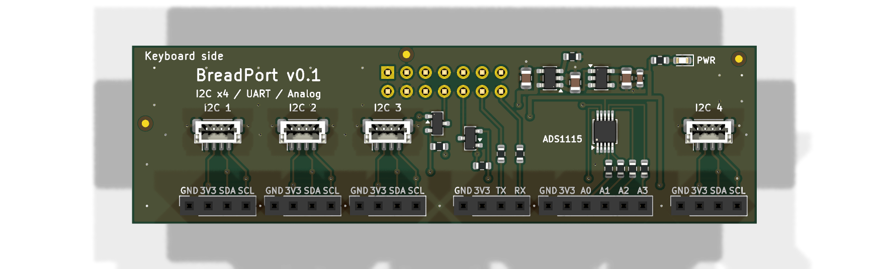

# BreadPort

A cap for the M5Stack CardputerZero's top expansion port that breaks out the I2C bus to four STEMMA QT / Qwiic
connectors and four 0.1 in sockets, plus a UART socket and four analog inputs (on-board ADS1115 ADC). The host is
protected by a current-limited power switch and an I2C isolator. See [SPEC.md](SPEC.md) for the design, pinout, BOM
and cost.



## Files

| File | What it is |
| --- | --- |
| `BreadPort.kicad_pro`, `.kicad_sch`, `.kicad_pcb` | KiCad 10 project (generated; open and edit as usual) |
| `BreadPort.kicad_sym`, `sym-lib-table` | Project symbol library (SY6280AAC, which KiCad doesn't ship) |
| `tools/design.py` | Board size, pin maps, socket positions, parts and nets: the single source for both generators |
| `tools/gen_schematic.py` | Writes the schematic from `design.py` |
| `tools/gen_pcb.py` | Writes the PCB: placement, routing, fiducials and GND pours |

## Rebuild

The scripts find KiCad 10 in `C:\Program Files\KiCad\10.0` or in the per-user location winget installs to
(`%LOCALAPPDATA%\Programs\KiCad\10.0`). Set `KICAD_DIR` to use another install.

```powershell
python tools\gen_schematic.py
```

```powershell
& "$env:LOCALAPPDATA\Programs\KiCad\10.0\bin\python.exe" tools\gen_pcb.py
```

Then check it:

```powershell
& "$env:LOCALAPPDATA\Programs\KiCad\10.0\bin\kicad-cli.exe" sch erc --severity-all BreadPort.kicad_sch
```

```powershell
& "$env:LOCALAPPDATA\Programs\KiCad\10.0\bin\kicad-cli.exe" pcb drc --schematic-parity --severity-all BreadPort.kicad_pcb
```

Regenerating overwrites hand edits to the schematic and PCB. Once you start editing in KiCad, stop using the generators.

Fab output comes from the `gerber-check` MCP server's `export_for_fab` tool (profile `jlcpcb_standard` or
`pcbway_standard`), which writes to `fab/<profile>/`.
