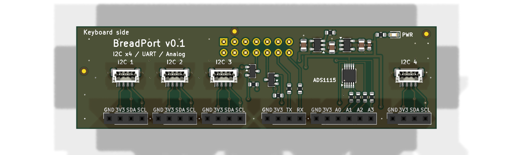
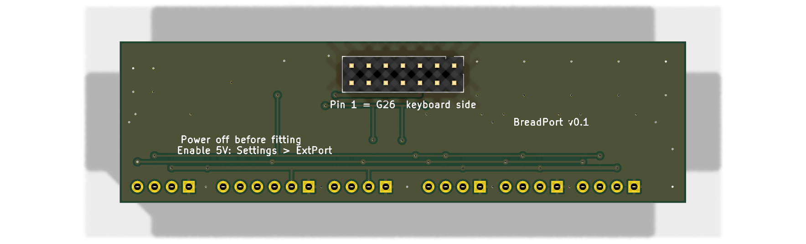
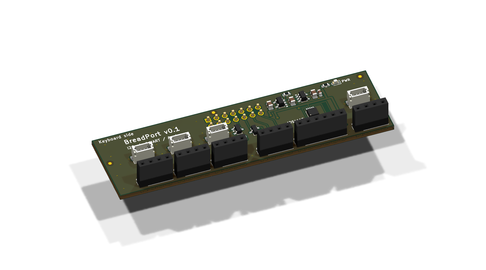

# BreadPort: spec

Status: v0.1 designed 2026-11-25. KiCad ERC, DRC and schematic parity are clean. gerber-check gives WARN for JLCPCB and
PCBWay: the only finding is the 0.8 mm socket pin labels, which are smaller than JLCPCB's 1.0 mm advice. The
assembly check passes. Not yet fabricated.

## Purpose

A cap board for the CardputerZero's top expansion port (EXT 2.54-14P) that turns it into a breadboard-friendly I/O
port:

- **I2C x4.** Four STEMMA QT / Qwiic connectors (JST SH 4-pin, 3.3 V) and four 0.1 in sockets on the same bus.
- **UART.** The host's G14/G15 on a 0.1 in socket.
- **Analog x4.** The port has no analog lines: the CardputerZero is a Raspberry Pi CM0 (BCM2837), which has no ADC.
  BreadPort adds an ADS1115 16-bit ADC on the I2C bus and brings its four inputs to a 0.1 in socket.
- **Host protection.** Nothing plugged into BreadPort can overload the host's 5 V output, back-feed it, or drag down
  the host's internal I2C bus.

## Host interface: CardputerZero top port

Same connector, position and pin map as [LightSensingPCB](../LightSensingPCB/SPEC.md), from M5Stack's
[CardputerZero docs](https://docs.m5stack.com/en/CardputerZero) and schematic V0.6.1:

| Host pin | Signal | BreadPort net | Use |
| --- | --- | --- | --- |
| 4 | GND | GND | |
| 6 | 5VOUT | +5V | Switched by the host, **off by default** (Settings > ExtPort). Under 500 mA, shared with the Grove port |
| 8 | G2 I2C1 SDA | SDA_HOST | Host side of Q1 |
| 10 | G3 I2C1 SCL | SCL_HOST | Host side of Q2 |
| 12 | G14 UART TX | TX_HOST | Through R10 to the UART socket |
| 14 | G15 UART RX | RX_HOST | Through R11 to the UART socket |

Pins 1, 2 (5VIN), 3, 5, 7, 9, 11 and 13 are not connected. 5VIN is left open so the cap never back-feeds the host.

The host's I2C1 already carries 0x10, 0x32, 0x34 (keyboard), 0x4F, 0x55 and 0x68. The ADS1115 uses **0x48**, so
external devices must avoid all seven addresses.

G14/G15 are also the Grove port's default function (its I2C/UART switch defaults to UART). Use BreadPort's UART or the
Grove port's, not both.

## Electrical design

### Power and overload protection

| Stage | Part | What it does |
| --- | --- | --- |
| Current limit | U1 SY6280AAC, R1 18k | Load switch on 5VOUT. Limit = 6800 / R1 = **378 mA typical**, ±25% at the datasheet's test point, so about 280-470 mA. Thermal shutdown with auto-retry. Soft start limits inrush when the host turns 5VOUT on. Blocks reverse current, so BreadPort can't back-feed the host's 5 V |
| 3.3 V | U2 AP2112K-3.3 | 600 mA LDO from the switched 5 V. Every connector's 3V3 pin comes from here |
| Decoupling | C1-C3 10 uF, C4 100 nF | Switch input, switch output / LDO input, LDO output, ADC |
| Indicator | D1, R9 1k | Green-yellow LED on 3.3 V: lit means ExtPort 5 V is on and the cap is powered |

The host's 5VOUT budget (under 500 mA) is shared with its Grove port. The limit stops a short or an overload on
BreadPort from tripping the host, but the limit is close to the shared budget: if the Grove port is also in use,
keep BreadPort's loads small.

No connector carries 5 V. Every 3V3 pin draws from the same protected 3.3 V rail.

### I2C isolation

Q1 and Q2 (BSS138) are pass gates between the host's I2C1 and BreadPort's bus, with their gates on BreadPort's 3.3 V
rail, source on BreadPort's side and drain on the host's.

- **Powered:** a bidirectional switch, the standard MOSFET I2C level-shifter circuit with 3.3 V on both sides. R2/R3
  (4.7k) pull BreadPort's side up; the host already has pull-ups on its side.
- **Unpowered** (5VOUT off, the default): the gates sit at 0 V and the body diodes face the host, so the host's I2C1
  is cut off. Without this, external boards' pull-ups to a dead rail (and their ESD diodes) would load the bus the
  keyboard, RTC and IMU share.

The isolator doesn't protect against a device holding SDA or SCL low while powered: that still stalls the host's bus,
as it would with a direct connection.

### UART

R10/R11 (1k) in series with TX and RX limit current if the device on the other end is unpowered (back-powering
through its ESD diodes) or drives 5 V. Logic is 3.3 V; the resistors don't level-shift.

### Analog inputs

U3 ADS1115 (VSSOP-10), ADDR to GND (address 0x48), ALERT/RDY not connected. A0-A3 go through R5-R8 (1k) to AIN0-3,
which limits the current into the ADC's clamp diodes if an input goes outside the supply rails. Inputs read 0-3.3 V
single-ended: set the PGA to ±4.096 V for the full range. The 1k adds negligible error against the ADS1115's input
impedance.

### Nets

| Socket | Pins (left to right) |
| --- | --- |
| I2C 1-4 (J6-J9) | GND, 3V3, SDA, SCL |
| UART (J10) | GND, 3V3, TX (host output, G14), RX (host input, G15) |
| Analog (J11) | GND, 3V3, A0, A1, A2, A3 |
| Qwiic 1-4 (J2-J5) | 1 GND, 2 3V3, 3 SDA, 4 SCL (STEMMA QT / Qwiic standard) |

## Board

| Item | Value |
| --- | --- |
| Outline | 84 x 24 mm, same as M5Stack's Cap modules and LightSensingPCB |
| Stack-up | 2 layers, 1.6 mm FR-4, 1 oz copper |
| Rules | 0.25 mm signal tracks (0.2 mm at the ADC), 0.5 mm power, 0.3 mm clearance to pours, 0.8/0.3 mm vias, 0.3 mm copper to edge. U3's pads are 0.15 mm apart (0.5 mm pitch), so its footprint carries a 0.15 mm local clearance |
| J1 | 2x7 2.54 mm male header on the **bottom**, pins down into the host |
| Top side | Everything else. Qwiic connectors (vertical, 4.25 mm tall) above their sockets; 0.1 in sockets (8.5 mm tall) along the back edge |
| Routing | SDA, SCL and 3V3 run the length of the board as bottom-layer lanes between the Qwiics and the sockets. GND pours on both layers |
| Fiducials | Three, for pick-and-place (U3 is fine-pitch) |
| Retention | Header friction only, like LightSensingPCB |

## Bill of materials

| Ref | Part | LCSC | Price each (LCSC, 2026-11-25) |
| --- | --- | --- | --- |
| J1 | BOOMELE 2.54-2*7P male header | C71397 | $0.108 (5+) |
| J2-J5 | Megastar ZX-SH1.0-4PLT, SH 1.0 mm 4-pin vertical (JST BM04B-SRSS-TB equivalent; the JST part is out of stock) | C7430453 | $0.078 (5+) |
| J6-J10 | CONNFLY DS1023-1x4SF11, 1x4 2.54 mm female, 8.5 mm | C7509546 | $0.055 (10+) |
| J11 | BOOMELE 2.54-1*6P female header | C40877 | $0.093 (5+) |
| U1 | Silergy SY6280AAC, SOT-23-5 | C55136 | $0.089 (5+) |
| U2 | Diodes AP2112K-3.3TRG1, SOT-23-5 | C51118 | $0.168 (5+) |
| U3 | TI ADS1115IDGSR, VSSOP-10 | C37593 | $1.231 (1+) |
| Q1, Q2 | onsemi BSS138LT1G, SOT-23 | C82045 | $0.042 (1+) |
| R1 | 18k 0603 1% | C25810 | basic part |
| R2, R3 | 4.7k 0603 1% | C23162 | basic part |
| R5-R11 | 1k 0603 1% | C21190 | basic part |
| C1-C3 | Samsung CL21A106KAYNNNE 10 uF 25 V X5R 0805 | C15850 | basic part |
| C4 | 100 nF 50 V X7R 0603 | C14663 | basic part |
| D1 | Everlight 19-217/G7C-AN1P2/6T, 0603 green-yellow LED (2.0 V, so it lights from 3.3 V through 1k) | C2986030 | $0.013 (1+) |

All are JLCPCB extended parts except the resistors and capacitors. Parts cost about $2.50 per board, $1.23 of it the
ADS1115.

## Cost

The outline matches LightSensingPCB, so the bare-board price is the same: about $5 for 5 boards at JLCPCB or PCBWay
(see [its quote](../LightSensingPCB/SPEC.md#cost-live-quotes-2026-11-24-5-boards)), plus shipping. Assembly adds
JLCPCB's or PCBWay's SMT fees, extended-part fees and through-hole soldering for the seven connectors.

## Fabrication files

Run `export_for_fab` (gerber-check) on `BreadPort.kicad_pcb` with profile `jlcpcb_standard` or `pcbway_standard`. It
writes the fab zip, stencil zip, assembly files (`bom_jlcpcb.csv`, `cpl_jlcpcb.csv` for JLCPCB) and an order sheet to
`fab/<profile>/` (ignored by git). The gerber check suggests ENIG finish for the fine-pitch ADC.

## Verify before ordering

- **UART pin swap.** M5Stack's docs table puts G15 RXD on pin 12 and G14 TXD on pin 14; the port photo and schematic
  have them the other way round (what BreadPort uses). Check with a loopback or a scope before relying on TX/RX labels.
- **Pin 1 orientation.** It comes from M5Stack's port photo; check it against your unit's port silkscreen.
- **Qwiic connector land pattern.** The footprint is KiCad's JST BM04B-SRSS-TB; check it against the Megastar
  ZX-SH1.0-4PLT drawing (or use a genuine JST part when it's back in stock).
- **First power-up.** Fit the cap with the CardputerZero off, enable ExtPort 5 V, and check 3.3 V at any 3V3 pin and
  that D1 lights, before plugging anything in. Then run `i2cdetect` (I2C1 on the CM0 is normally `i2c-1`): 0x48 should
  appear alongside the host's own devices.
- **Current limit.** With a resistive load on a 3V3 pin, check that U1 limits at roughly 380 mA (at 5 V) and that the
  host stays up.
- The 3D fit (header seating height, case lip at the top edge) has not been checked against the STL model.
