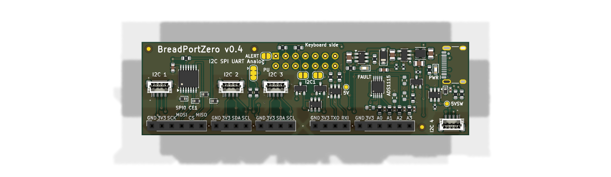

# BreadPortZero

A cap for the M5Stack CardputerZero's top expansion port that adds:
- an I2C bus on four STEMMA QT / Qwiic connectors and two 0.1 in sockets;
- an SPI socket (SPI0, chip select CE1), buffered;
- a UART socket;
- four analog inputs, from an on-board ADS1115 ADC, with unfitted divider pads for 5 V signals;
- a USB-C jack for extra power: about 1 A at 3.3 V instead of about 250 mA from the host.

The host is protected in five ways:
- a current-limited power switch (234-303 mA), with a FAULT LED that lights while it limits, and a second one
  (1.09-1.26 A) on the USB input; neither source can back-feed the other;
- an I2C isolator with ESD protection;
- an SPI buffer that keeps breadboard wiring off the display's bus and drops off it when the cap is unpowered;
- ESD protection on the SPI and UART lines, series resistors on the UART, series resistors and filter capacitors on
  the analog inputs;
- its own I2C bus on G22/G23, so external devices can't disturb the host's keyboard bus.

USB only powers the cap while the host's ExtPort 5 V is on. Bridge JP9 and a script can power-cycle everything plugged
in by driving G7 high (then the SPI socket can't be used).

The bottom silkscreen is the board's manual: setup steps (including the `config.txt` line), a ports table, the host
pinout beside every J1 pin, what each jumper does, a power-path diagram and what the LEDs mean.

See [SPEC.md](SPEC.md) for the design, pinout, solder jumpers, BOM and cost.



## Host setup

BreadPortZero's I2C bus is a software bus on G22 (SDA) / G23 (SCL). Add this to `/boot/firmware/config.txt`, reboot, and
turn on Settings > ExtPort:

```
dtoverlay=i2c-gpio,bus=3,i2c_gpio_sda=22,i2c_gpio_scl=23
```

The bus is `/dev/i2c-3`, and the ADS1115 answers at 0x48 (`i2cdetect -y 3`).

To put the bus on the host's I2C1 instead:
- Bridge JP1 and JP2.
- Cut JP8.
- Leave out the overlay.

To let software power-cycle the cap (for example to reset a hung I2C board), bridge JP9 and drive G7:

```
pinctrl set 7 op dh    # off
pinctrl set 7 op dl    # on
```

Hold it off for about a second so the rails drain. G7 is also the SPI socket's chip select (SPI0 CE1), which idles
high, so JP9 and SPI exclude each other: with JP9 bridged, keep the SPI driver off G7 (for example
`dtoverlay=spi0-1cs`).

The SPI socket is SPI0's CE1 (`/dev/spidev0.1`, if the host's image creates it alongside the display on CE0). Its
pins, left to right: GND, 3V3, SCK, MOSI, CS, MISO.

For more than about 250 mA at 3.3 V, plug a USB-C charger into the jack on the right end (power only; up to about 1 A
at 3.3 V). ExtPort 5 V must still be on.

The other jumpers are listed in [SPEC.md](SPEC.md#solder-jumpers).

## Files

| File | What it is |
| --- | --- |
| `BreadPortZero.kicad_pro`, `.kicad_sch`, `.kicad_pcb` | KiCad 10 project (generated; open and edit as usual) |
| `BreadPortZero.kicad_sym`, `sym-lib-table` | Project symbol library (TPS2553, TLV62569, 74LVC125: KiCad doesn't ship them in this form) |
| `BreadPortZero.pretty`, `fp-lib-table` | Project footprint library: the USB-C jack's KiCad footprint with fab-rule fixes |
| `tools/design.py` | Board size, pin maps, socket positions, parts and nets: the single source for both generators |
| `tools/gen_schematic.py` | Writes the schematic from `design.py` |
| `tools/gen_pcb.py` | Writes the PCB: placement, routing, fiducials, GND pours and silkscreen (including the bottom's reference text) |
| `tools/make_footprints.py` | Writes `BreadPortZero.pretty` from KiCad's stock footprints (run with KiCad's Python) |

## Rebuild

The scripts find KiCad 10 in `C:\Program Files\KiCad\10.0` or in the per-user location winget installs to
(`%LOCALAPPDATA%\Programs\KiCad\10.0`). Set `KICAD_DIR` to use another install.

```powershell
python tools\gen_schematic.py
```

```powershell
& "$env:LOCALAPPDATA\Programs\KiCad\10.0\bin\python.exe" tools\gen_pcb.py
```

Then check it:

```powershell
& "$env:LOCALAPPDATA\Programs\KiCad\10.0\bin\kicad-cli.exe" sch erc --severity-all BreadPortZero.kicad_sch
```

```powershell
& "$env:LOCALAPPDATA\Programs\KiCad\10.0\bin\kicad-cli.exe" pcb drc --schematic-parity --severity-all BreadPortZero.kicad_pcb
```

Regenerating overwrites hand edits to the schematic and PCB. Once you start editing in KiCad, stop using the generators.

Fab output comes from the `gerber-check` MCP server's `export_for_fab` tool (profile `jlcpcb_standard` or
`pcbway_standard`), which writes to `fab/<profile>/`.
