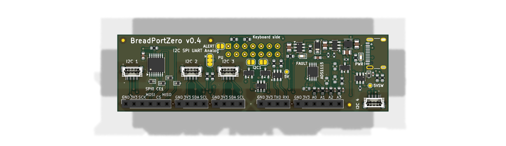
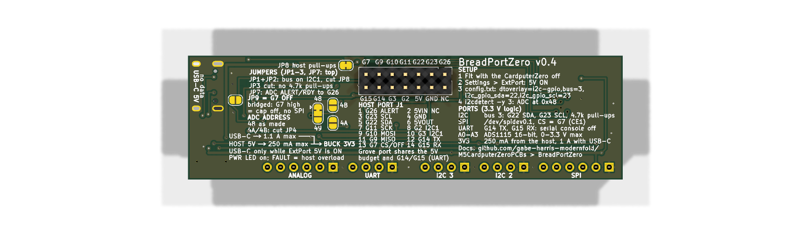
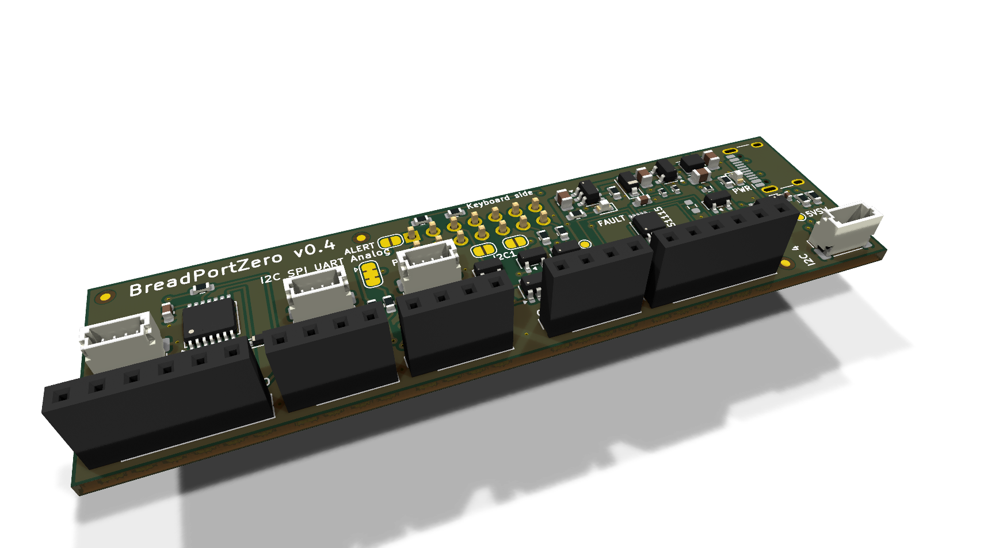

# BreadPortZero: spec

Status: v0.4 designed 2026-11-25. v0.4 adds a buffered SPI socket and USB-C supplemental power, with a 3.3 V buck in
place of the LDO (see [Changes](#changes)).

**Checks:**
- KiCad ERC, DRC and schematic parity are clean.
- gerber-check gives WARN for JLCPCB and PCBWay, for four reasons, none of them a defect:
  - The bridged solder jumpers JP3, JP4 and JP8 join their nets, as intended.
  - The 0.8-0.9 mm labels and bottom reference text are smaller than JLCPCB's 1.0 mm advice (PCBWay's 0.8 mm minimum
    is met); short pin-1 marks and some footprints' 0.12 mm outline segments get read as tiny or thin text.
  - Footprint silk on the test pads and some 0402 resistors sits close to their pads; the fab trims it.
  - Tombstoning risk on R16, R17 and R18: R16's GND pad already has thermal relief, and R17/R18 are unfitted.
- The assembly check passes (INFO items only).

Not yet fabricated.

## Purpose

A cap board for the CardputerZero's top expansion port (EXT 2.54-14P) that turns it into a breadboard-friendly I/O
port:

- **I2C.** Four STEMMA QT / Qwiic connectors (JST SH 4-pin, 3.3 V) and two 0.1 in sockets on the same bus.
- **SPI.** The host's SPI0 (CE1) on a 0.1 in socket, buffered.
- **UART.** The host's G14/G15 on a 0.1 in socket.
- **Analog x4.** The port has no analog lines: the CardputerZero is a Raspberry Pi CM0 (BCM2837), which has no ADC.
  BreadPortZero adds an ADS1115 16-bit ADC on the I2C bus and brings its four inputs to a 0.1 in socket.
- **More power.** A USB-C jack adds 5 V from a charger: about 1 A at 3.3 V instead of about 250 mA.
- **Host protection.** Nothing plugged into BreadPortZero can:
  - overload the host's 5 V output or back-feed it;
  - hang or load the host's internal I2C bus, which the keyboard shares;
  - load or disturb the SPI bus the host's display runs on;
  - carry ESD into the host's GPIOs.

## Host interface: CardputerZero top port

Same connector, position and pin map as [LightSensingPCB](../LightSensingPCB/SPEC.md), from M5Stack's
[CardputerZero docs](https://docs.m5stack.com/en/CardputerZero) and schematic V0.6.1:

| Host pin | Signal | BreadPortZero net | Use |
| --- | --- | --- | --- |
| 1 | G26 | ALERT_HOST | ADS1115 ALERT/RDY, only if JP7 is bridged |
| 3 | G23 | SCL_HOST | **BreadPortZero's I2C SCL** (software bus), host side of Q2 |
| 4 | GND | GND | |
| 5 | G22 | SDA_HOST | **BreadPortZero's I2C SDA** (software bus), host side of Q1 |
| 6 | 5VOUT | +5V | Switched by the host, **off by default** (Settings > ExtPort). Under 500 mA, shared with the Grove port |
| 7 | G11 SPI0 SCLK | SCK_HOST | U7 input, to the SPI socket's SCK |
| 8 | G2 I2C1 SDA | I2C1_SDA | Only through JP1 (open) |
| 9 | G10 SPI0 MOSI | MOSI_HOST | U7 input, to the SPI socket's MOSI |
| 10 | G3 I2C1 SCL | I2C1_SCL | Only through JP2 (open) |
| 11 | G9 SPI0 MISO | MISO_HOST | U7 output, from the SPI socket's MISO, driven only while CS is low |
| 12 | G14 UART TX | TX_HOST | Through R10 to the UART socket |
| 13 | G7 SPI0 CE1 | G7_HOST | The SPI socket's CS (through U7); power switch control instead, if JP9 is bridged |
| 14 | G15 UART RX | RX_HOST | Through R11 to the UART socket |

Pin 2 (5VIN) is not connected, so the cap never back-feeds the host.

### BreadPortZero's I2C bus is separate from the host's

The host's I2C1 (G2/G3) carries the keyboard (0x34), RTC, IMU and other devices at 0x10, 0x32, 0x4F, 0x55 and 0x68. If
external devices shared it:
- one that held SDA low would freeze the keyboard;
- common parts would clash with the host's addresses (MPU-6050, ICM-20948 and DS3231 all use 0x68);
- devices that stretch the clock would misbehave, because the Pi's hardware I2C controller handles clock stretching
  badly (documented for the BCM2835; the CM0's BCM2837 uses the same I2C block).

So BreadPortZero's bus runs on G22 (SDA) and G23 (SCL) as a software I2C bus. The kernel's bit-banged driver handles clock
stretching. Add this to `/boot/firmware/config.txt` and reboot:

```
dtoverlay=i2c-gpio,bus=3,i2c_gpio_sda=22,i2c_gpio_scl=23
```

The bus appears as `/dev/i2c-3` (`i2cdetect -y 3`) and runs at about 100 kHz. The only address in use on it is the
ADS1115's (0x48 as made).

**To use the host's I2C1 instead:**
- Bridge JP1 and JP2.
- Cut JP8.
- Leave out the overlay, so G22/G23 stay inputs.

The external devices then share I2C1 with the host's own devices and must avoid their addresses.

G14/G15 are also the Grove port's default function (its I2C/UART switch defaults to UART). Use BreadPortZero's UART or the
Grove port's, not both.

### The SPI socket shares the display's bus

G11/G10/G9 are SPI0, which also drives the CardputerZero's display (chip select CE0, G8, not on the port). The socket
uses the second chip select, CE1 (G7). Through the kernel's spidev driver that is `/dev/spidev0.1`, if the host's image
creates it alongside the display; check yours (see [Verify before ordering](#verify-before-ordering)).

## Electrical design

### Power and overload protection

Two 5 V sources feed one rail, +5V_SW, which the 3.3 V buck runs from:

| Stage | Part | What it does |
| --- | --- | --- |
| Host current limit | U1 TPS2553, R1 100k | Load switch on 5VOUT. TI's I_OS equations give **234-303 mA** (min-max over temperature and process) with R_ILIM = 100k, so BreadPortZero can never take the host's whole 500 mA budget. Constant-current limiting, then thermal cycling. Soft start (about 1 ms) limits inrush when the host turns 5VOUT on. R15 (100k) holds EN high; see [Power switch](#power-switch) |
| Host diode | D3 B5819W | U1's output to +5V_SW. It drops about 0.3-0.45 V, so USB (when present) sits higher and carries the load, and it stops USB back-feeding the host's 5VOUT |
| USB input | J13 USB-C, R22/R23 5.1k, D4 ESD5Z5.0, C11 1 µF | Power only (D+/D-/SBU unconnected). The 5.1k Rd on CC1/CC2 asks a USB-C source for 5 V. D4 clamps VBUS hot-plug ringing and ESD (U6's IN is rated 7 V); C11 is kept small to limit that ringing |
| USB current limit | U6 TPS2553, R24 22k | **1.09-1.26 A**, so a fault on the cap can't overload the charger or the jack. With VBUS gone it blocks the rail from flowing back out of the jack (1 µA max). Its EN is U1's, so **USB only powers the cap while the host's 5VOUT is on** (and the power switch is on). Its FAULT output is left open |
| 3.3 V | U2 TLV62569, L1 2.2 µH, R25 100k / R26 22k | Synchronous buck from +5V_SW, 0.6 V x (1 + 100k/22k) = 3.33 V. Rated 2 A, about 90% efficient at these loads. Its EN is U1's too |
| Fault indicator | D2 (red), R14 1k | From the unswitched 5 V into U1's open-drain FAULT output (about 3 mA). Lights while U1 limits current or is in thermal shutdown. U1 filters FAULT for about 7.5 ms, so hot-plug inrush doesn't blink it. It watches the host path only |
| Decoupling | C1, C2, C3 10 µF, C9 22 µF | U1's input, the buck's input, the buck's output plus bulk. C1 keeps the host's 5V input at 10 µF (the USB hot-plug ceiling). C9 rides out the inrush of a hot-plugged Qwiic board, so the ADC doesn't reset and Q1/Q2's gates don't sag mid-transfer |
| Indicator | D1, R9 1k | Green-yellow LED on 3.3 V: lit means the cap is powered (or something is back-feeding 3V3) |

U1's and U2's GND pins have a solid pour connection (no thermal relief), since it is their main heat path.

**Switching between sources is seamless.** U1 stays on whether or not USB is plugged in: plug USB in and +5V_SW rises,
D3 turns off and the host path idles; unplug it and +5V_SW falls back onto D3. C2 bridges the step, so nothing restarts.

**What the LEDs mean:**

| PWR (D1) | FAULT (D2) | State |
| --- | --- | --- |
| Off | Off | ExtPort 5 V is off, or the power switch is off |
| On | Off | Normal |
| Dim, on or off | On | Overload on host power: the load is above U1's limit, or U1 is cycling in thermal shutdown |

On USB power an overload trips U6, which has no LED: PWR dims or goes out.

**3.3 V budget:**
- **Host only: about 250 mA** for everything plugged in. U1's 234 mA minimum at about 4.6 V, through the buck at about
  88%, gives 285 mA at 3.3 V before the cap's own few mA and some margin. The host's 5VOUT (under 500 mA) is shared
  with its Grove port, and U1's worst-case 303 mA leaves about 200 mA for it.
- **With USB: about 1 A.** U6's 1.09 A minimum at 4.75 V through the buck gives about 1.35 A; the Qwiic connectors
  (1 A per contact) and the 0.5 mm 3V3 tracks set the practical figure. The USB source must supply what you draw: about
  0.8 A at 5 V for 1 A at 3.3 V, so a 500 mA laptop port tops out around 650 mA at 3.3 V.

No connector carries 5 V.

**One 3.3 V source per bus.** Don't plug in a board that drives its own 3.3 V onto the Qwiic 3V3 pin (some
microcontroller boards do): it fights U2, which can't sink current at light load.

### Power switch

Software can turn BreadPortZero off and on, to reset a hung I2C board or save power, without touching the Grove port
(which shares the host's ExtPort switch).

- R15 (100k from the unswitched 5 V) holds EN high: on whenever 5VOUT is. EN drives U1, U6 and U2, so it turns off
  both 5 V paths and the buck.
- Q3 (BSS138) pulls EN low when its gate is high. Its gate reaches G7 only through JP9 (bottom), open as made.
- R16 (10k) holds the gate low while JP9 is open or G7 floats. It also beats the Pi's default pull-up on G7 (GPIO 0-8
  pull up at reset, about 50k): 3.3 V x 10k / 60k = 0.55 V, under the BSS138's 0.85 V minimum threshold. So the cap
  stays on through the host's boot.

Bridge JP9, then `pinctrl set 7 op dh` turns the cap off and `pinctrl set 7 op dl` turns it back on (G7 sources
0.33 mA into R16 while high). Hold it off for about a second: neither switch discharges its output, and the rails drain
through their loads.

While the cap is off:
- Q1/Q2 open, so the external bus is cut off from G22/G23, as when ExtPort is off.
- G22/G23 read low through R12/R13 into the dead 3.3 V rail; reprobe the bus (`i2cdetect -y 3`) after turning it on.

**JP9 and SPI exclude each other.** G7 is also the SPI socket's CS, which idles high: with JP9 bridged, an SPI
transfer would turn the cap off. Keep JP9 open to use SPI. With JP9 bridged, keep the SPI driver off G7 (for example
`dtoverlay=spi0-1cs`).

### SPI buffer

U7 (74LVC125, 3.3 V) sits between the host's SPI0 pins and the socket:

| U7 channel | From | To | Output enable |
| --- | --- | --- | --- |
| 1 | G11 (SCLK) | Socket SCK | Always |
| 2 | G10 (MOSI) | Socket MOSI | Always |
| 3 | G7 (CE1) | Socket CS | Always |
| 4 | Socket MISO | G9 (MISO) | Only while G7 (CS) is low |

- **The display's bus stays clean.** The host's pins see only U7's inputs (a few pF each), not the wiring and devices on
  the breadboard. MISO is driven onto G9 only while the socket's device is selected, so it can't fight anything else on
  SPI0.
- **Unpowered, it disappears.** The 74LVC125's partial-power-down (Ioff) spec keeps its pins high-impedance with VCC
  at 0 V, so with ExtPort off (or the power switch off) the display's SPI is unaffected.
- **Defined levels.** R21 (100k) pulls the socket's MISO up, so U7's input doesn't float with nothing plugged in.
- **Speed.** U7 adds about 5 ns each way; breadboard wiring, not the buffer, sets the clock limit.
- **ESD.** D5-D8 (ESD5Z5.0) clamp the four socket lines next to their tracks. U7's inputs are 5 V tolerant, but the
  socket's outputs drive 3.3 V: SPI devices must accept 3.3 V logic.

C10 (100 nF) decouples U7.

### I2C isolation and pull-ups

Q1 and Q2 (BSS138) are pass gates between the host's G22/G23 and BreadPortZero's bus. Their gates are on BreadPortZero's 3.3 V
rail, source on BreadPortZero's side, drain on the host's.

- **Powered:** a bidirectional switch, the standard MOSFET I2C level-shifter circuit with 3.3 V on both sides.
- **Unpowered** (5VOUT off, the default): the gates sit at 0 V and the body diodes face the host, so the external bus
  (and anything plugged into it) is cut off from the host's pins.

The circuit needs pull-ups on both sides:
- **BreadPortZero's side:** R2/R3 (4.7k). They are required, because each FET stops conducting at 3.3 V − V_GS(th) (about
  2.0 V), below the 2.31 V an I2C input needs. Cut JP3 to remove them if your boards bring strong pull-ups of their own:
  SparkFun boards typically carry 2.2k-4.7k, Adafruit 10k. With JP3 intact, two 2.2k boards plus R2 already exceed the
  I2C spec's 3 mA sink current.
- **Host's side:** R12/R13 (10k) from G22/G23. They feed from 3.3 V through JP8, which you cut if you bridge JP1/JP2:
  I2C1 has its own pull-ups, and these would load it through BreadPortZero's unpowered rail.

**Bus speed:** 4.7k alone allows about 75 pF at 400 kHz. The software bus runs at about 100 kHz, which suits several
Qwiic cables. At 400 kHz (I2C1 mode), keep the cables short.

### ESD protection

| Lines | Part | Where |
| --- | --- | --- |
| SDA, SCL | U4 USBLC6-2SC6 | BreadPortZero's side, next to Q1/Q2; rail pin on 3.3 V, ground straight to the UART socket's GND pin |
| TX, RX | U5 USBLC6-2SC6 | Socket side of R10/R11, so a strike is clamped before it reaches the resistor. Flow-through: each line enters one pin and leaves by its twin |
| SCK, MOSI, CS, MISO | D5-D8 ESD5Z5.0 | One per socket line, next to U7 (its interleaved pinout leaves no room for a 4-line array) |
| USB VBUS | D4 ESD5Z5.0 | At U6's input |

U4 is needed even when BreadPortZero is off: a positive strike on any of the I2C connectors would otherwise pass through
the BSS138's body diode into the host's GPIO.

The analog inputs need no array: each 100 nF filter capacitor soaks up an IEC 61000-4-2 contact discharge (150 pF at
8 kV gives about 12 V on 100 nF), and the 1k limits what is left.

### UART

R10/R11 (4.7k) in series with TX and RX limit current to under 0.6 mA:
- into the host's RX clamp diode, if the device drives 5 V (the host's pins aren't 5 V tolerant);
- out of the host's TX, into a device that is unpowered.

With about 10 pF of load (U5 adds about 1 pF more) the RC is about 50 ns, irrelevant up to 1 Mbaud. Logic is 3.3 V;
the resistors don't level-shift. U5 clamps ESD on the socket side (see [ESD protection](#esd-protection)).

The socket is labelled TXO (host output, G14) and RXI (host input, G15). G14/G15 often carry the Linux serial console:
disable it (`raspi-config` > Interface > Serial) before connecting a device.

### Analog inputs

U3 is an ADS1115 (VSSOP-10). C4 (100 nF) sits at its VDD pin, with its own GND via. The buck's feedback divider senses
the rail at C4, so the regulation point is the ADC's supply.

Each input passes through R5-R8 (1k) and C5-C8 (100 nF) to AINx:
- **Filter:** a 1.6 kHz anti-alias filter. TI suggests a cutoff between the data rate and 10× it; that suits all rates
  up to 860 SPS. It also keeps the buck's 1.5 MHz ripple off the inputs.
- **Protection:** the resistor limits current into the ADC's clamp diodes if an input leaves the rails.

Inputs read 0-3.3 V single-ended. Set the PGA to ±4.096 V for the full range. The 1k's error against the ADS1115's
6 MΩ common-mode input impedance is about 0.017%, inside the part's own gain error.

**Inputs are 0-3.3 V only. Use a divider for 5 V signals.** Above 3.3 V, an input pushes current through the ADC's
clamp into the 3.3 V rail. The buck can't sink current at light load, and with nothing plugged in the rail draws only a
few mA, so two inputs at 5 V (about 1.4 mA each) would lift it.

**Divider pads.** R17-R20 are unfitted 0603 positions from AIN0-AIN3 to GND, so R5-R8 become the top of a divider:

| Input range | R5-R8 (top) | R17-R20 (bottom) | Reads at full input | Load on the source |
| --- | --- | --- | --- | --- |
| 0-3.3 V (as made) | 1k | not fitted | 3.3 V | about 6 MΩ |
| 0-5 V | 1k (as made) | 1.8k | 3.21 V | 2.8k |
| 0-5 V, light load | 10k | 18k | 3.21 V | 28k |
| 0-12 V | 10k | 3.3k | 2.98 V | 13.3k |

Scale the reading by (top + bottom) / bottom. A divider also changes the filter: its cutoff becomes 1 / (2π × (top ∥
bottom) × 100 nF), 2.5 kHz for 1k/1.8k and 250 Hz for 10k/18k. The ADS1115's input current makes a gain error of
roughly (top ∥ bottom) / 6 MΩ, about 0.1% for 10k/18k.

| Pad | Where |
| --- | --- |
| R17 (A0) | Left of R5, above the analog socket's 3V3 pin |
| R18 (A1) | Above C6 |
| R19 (A2), R20 (A3) | Between the A2 and A3 tracks, right of the ADC |

| ADDR jumpers (bottom) | Address |
| --- | --- |
| JP4 1-2 (as made, ADDR to GND) | 0x48 |
| JP4 2-3 (ADDR to VDD) | 0x49 |
| JP4 cut, JP6 bridged (ADDR to SDA) | 0x4A |
| JP4 cut, JP5 bridged (ADDR to SCL) | 0x4B |

0x48 is shared with TMP102/TMP117 sensors and other ADS1x15 boards. For 0x4A, TI asks for SDA held low at least 100 ns
after SCL falls; prefer 0x49 or 0x4B.

**ALERT/RDY:** open-drain, unconnected as made. Bridge JP7 to bring it to G26, and enable the Pi's internal pull-up on
G26 for conversion-ready interrupts.

### Solder jumpers

| Jumper | Side | As made | Purpose |
| --- | --- | --- | --- |
| JP1, JP2 | Top, below J1 | Open | Bridge both (and cut JP8) to put BreadPortZero's bus on the host's I2C1 instead of G22/G23 |
| JP3 | Top, between Qwiic 2 and 3 | Bridged | BreadPortZero-side 4.7k pull-ups. Cut to remove |
| JP4 | Bottom | 1-2 bridged | ADS1115 address: GND / VDD |
| JP5, JP6 | Bottom | Open | ADS1115 address: SCL / SDA (cut JP4 first) |
| JP7 | Top, left of J1 | Open | ADS1115 ALERT/RDY to G26 |
| JP8 | Bottom, top edge | Bridged | Host-side 10k pull-ups. Cut when JP1/JP2 are bridged |
| JP9 | Bottom, right end ("G7 OFF") | Open | Bridge to let G7 turn BreadPortZero off (see [Power switch](#power-switch)). No SPI while bridged |

### Test pads

TP1 +5V (host 5V, before U1) and TP2 +5V_SW (the buck's input, after D3 and U6). They are 1 mm pads on the top,
labelled. 3V3, GND, SDA and SCL are on every socket.

### Nets

| Socket | Pins (left to right) |
| --- | --- |
| SPI (J6) | GND, 3V3, SCK, MOSI, CS, MISO |
| I2C 2, I2C 3 (J7, J8) | GND, 3V3, SDA, SCL |
| UART (J10) | GND, 3V3, TXO (host output, G14), RXI (host input, G15) |
| Analog (J11) | GND, 3V3, A0, A1, A2, A3 |
| Qwiic 1-4 (J2-J5) | 1 GND, 2 3V3, 3 SDA, 4 SCL (STEMMA QT / Qwiic standard) |
| USB-C (J13) | VBUS, GND, CC1/CC2 (5.1k to GND); D+, D-, SBU unconnected |

## Board

| Item | Value |
| --- | --- |
| Outline | 84 x 24 mm, same as M5Stack's Cap modules and LightSensingPCB |
| Stack-up | 2 layers, 1.6 mm FR-4, 1 oz copper |
| Rules | Tracks: 0.25 mm signal (0.2 mm at the ADC and the CC lines), 0.5 mm power. 0.3 mm clearance to pours, 0.8/0.3 mm vias, 0.3 mm copper to edge. U3's pads are 0.15 mm apart (0.5 mm pitch), so its footprint carries a 0.15 mm local clearance |
| J1 | 2x7 2.54 mm male header on the **bottom**, pins down into the host |
| Top side | Every assembled part. Qwiic 1-3 along the middle, Qwiic 4 in the bottom-right corner (vertical, 4.25 mm tall); 0.1 in sockets (8.5 mm tall) along the back edge; the USB-C jack in the top-right corner, its opening 1 mm past the right edge |
| Bottom side | J1 (through-hole) and the copper-only jumpers JP4-JP6, JP8 and JP9: no SMD parts. The silkscreen is the board's manual, see [Silkscreen](#silkscreen) |
| Routing | SDA, SCL and 3V3 run the length of the board as bottom-layer lanes between the Qwiics and the sockets. A second 3.3 V run on the bottom feeds Q1/Q2, U4, U5 and JP4. The SPI lines run from J1 to U7 in a band along the bottom layer's top edge. G7, EN, PWR_OFF and a 5 V feed for R15 run on the bottom to the power switch right of the ADC; +5V_SW runs back from U6 to the buck along the top edge. GND pours on both layers |
| J13 footprint | KiCad's HCTL HC-TYPE-C-16P-01A, as a project copy (`BreadPortZero.pretty`, made by `tools/make_footprints.py`): the outer GND pads are 0.1 mm shorter at the peg end (0.28 mm to the pegs' holes instead of 0.18 mm, under the fabs' 0.2 mm rule) and the shell-leg pads 0.1 mm larger (0.25 mm ring instead of 0.20 mm). KiCad ships no 3D model for it, so the renders show only its pads |
| Fiducials | Three, for pick-and-place (U3 is fine-pitch) |
| Silkscreen | Top: title, socket pin names, Qwiic numbers, the SPI socket's bus (SPI0 CE1), LED, jumper and test-pad labels. Bottom: see [Silkscreen](#silkscreen) |
| Retention | Header friction only, like LightSensingPCB |

### Silkscreen

The top is mostly parts, so the bottom carries the reference, each block next to what it describes. Read from below
(USB-C end on the left):

| Where | What it says |
| --- | --- |
| SPI end | Title; setup in four steps (fit with power off, ExtPort 5V on, the `config.txt` overlay line, `i2cdetect -y 3`); a ports table (I2C bus 3 on G22/G23 with 4.7k pull-ups, SPI `/dev/spidev0.1` on CE1, UART on G14/G15 with the console off, A0-A3 range, the 3V3 budget); where the docs are |
| Around J1 | The GPIO beside every pin (NC for 5VIN), then a pin table with each pin's function, and that the Grove port shares the 5 V budget and G14/G15 |
| Below JP8 | What the top-side jumpers JP1-JP3 and JP7 do |
| Beside JP9 and JP4-JP6 | JP9: bridged, G7 high turns the cap off and SPI is lost. The ADC address: 48 as made, 49 on JP4 2-3, 4A/4B with JP4 cut |
| Power section | A drawn power path: USB-C through 1.1 A max and host 5V through 250 mA max into the 3.3 V buck; USB-C only while ExtPort 5V is ON; what the LEDs mean |
| USB-C end | "USB-C 5V, no data", between the jack's shell legs |
| Socket edge | Each socket's name under it |

Text is 0.8 mm (headings bolder): at PCBWay's minimum and under JLCPCB's 1.0 mm advice, so gerber-check notes it.





## Bill of materials

Prices are JLCPCB's parts-library prices on 2026-11-25 at the quantity break 5 boards need (1+ unless noted). Every
part was in stock.

| Ref | Part | LCSC | JLCPCB library | Price each | Per board |
| --- | --- | --- | --- | --- | --- |
| J1 | BOOMELE 2.54-2*7P male header | C71397 | Extended | $0.1077 | $0.108 |
| J2-J5 | Megastar ZX-SH1.0-4PLT, SH 1.0 mm 4-pin vertical (JST BM04B-SRSS-TB equivalent; the JST part is out of stock) | C7430453 | Extended | $0.0772 | $0.309 |
| J7, J8, J10 | CONNFLY DS1023-1x4SF11, 1x4 2.54 mm female, 8.5 mm | C7509546 | Extended | $0.0543 | $0.163 |
| J6, J11 | BOOMELE 2.54-1*6P female header | C40877 | Extended | $0.0920 | $0.184 |
| J13 | HCTL HC-TYPE-C-16P-01A, USB-C receptacle (SMD, through-hole shell legs) | C2894897 | Extended | $0.1088 | $0.109 |
| U1, U6 | TI TPS2553DBVR, SOT-23-6 | C55266 | Extended | $0.4456 (10+) | $0.891 |
| U2 | TI TLV62569DBVR, SOT-23-5 | C141836 | Extended | $0.0659 | $0.066 |
| L1 | Changjiang FTC252012S2R2MBCA, 2.2 µH, 1008 (2520 metric) | C5832372 | Extended | $0.0354 | $0.035 |
| U3 | TI ADS1115IDGSR, VSSOP-10 | C37593 | Extended | $1.22 | $1.220 |
| U4, U5 | ST USBLC6-2SC6, SOT-23-6 | C7519 | Extended | $0.1531 | $0.306 |
| U7 | TI SN74LVC125APWR, TSSOP-14 | C7813 | Extended | $0.3490 | $0.349 |
| Q1-Q3 | onsemi BSS138LT1G, SOT-23 | C82045 | Extended | $0.0413 | $0.124 |
| D1 | Everlight 19-217/G7C-AN1P2/6T, 0603 green-yellow LED (2.0 V, so it lights from 3.3 V through 1k) | C2986030 | Extended | $0.0156 | $0.016 |
| D2 | Hubei KENTO KT-0603R, 0603 red LED | C2286 | Basic | $0.0077 | $0.008 |
| D3 | JSCJ B5819W SL, Schottky, SOD-123 | C8598 | Basic | $0.0245 | $0.025 |
| D4-D8 | UMW ESD5Z5.0T1G, 5 V TVS, SOD-523 | C5199848 | Extended | $0.0141 | $0.071 |
| R1, R21 | 100k 0603 1% | C25803 | Basic | $0.0026 | $0.005 |
| R15, R25 | 100k 0402 1% | C25741 | Basic | $0.0009 | $0.002 |
| R2, R3, R10, R11 | 4.7k 0603 1% | C23162 | Basic | $0.0018 | $0.007 |
| R5-R9, R14 | 1k 0603 1% | C21190 | Basic | $0.0015 | $0.009 |
| R12, R13, R16 | 10k 0603 1% | C25804 | Basic | $0.0017 | $0.005 |
| R22, R23 | 5.1k 0603 1% | C23186 | Basic | $0.0015 | $0.003 |
| R24, R26 | 22k 0402 1% | C25768 | Basic | $0.0010 | $0.002 |
| R17-R20 | Not fitted (divider pads, 0603) | | | | |
| C1-C3 | Samsung CL21A106KAYNNNE 10 µF 25 V X5R 0805 | C15850 | Basic | $0.0310 | $0.093 |
| C4, C10 | YAGEO CC0603KRX7R9BB104, 100 nF 50 V X7R 0603 | C14663 | Basic | $0.0046 | $0.009 |
| C5-C8 | Samsung CL05B104KO5NNNC 100 nF 16 V X7R 0402 | C1525 | Basic | $0.0029 | $0.012 |
| C9 | Samsung CL21A226MAQNNNE 22 µF 25 V X5R 0805 | C45783 | Basic | $0.0915 | $0.092 |
| C11 | Samsung CL05A105KA5NQNC 1 µF 25 V X5R 0402 | C52923 | Basic | $0.0046 | $0.005 |
| | | | | **Parts** | **$4.23** |

14 extended part types (v0.3: 10). Every part, the USB-C jack included, is allowed in JLCPCB's Economic PCBA. Solder
jumpers, test pads and the divider pads are copper only: they aren't in the BOM or the position file (the divider pads
are also marked DNP).

## Cost

For 5 boards assembled by JLCPCB, 2026-11-25. The bare-board price is a live quote from JLCPCB's quote page (84.1 x
24.1 mm, 2 layers, 1.6 mm, 1 oz, tented vias, entered by hand). The assembly lines apply JLCPCB's published
[Economic PCBA fees](https://jlcpcb.com/help/article/pcb-assembly-price) to this BOM; their exact assembly quote needs
the gerbers, BOM and position file uploaded.

| Item (5 boards) | Cost |
| --- | --- |
| Bare boards, ENIG (the gerber check suggests it for the 0.5 mm-pitch ADC) | $20.90 ($4.00 with leaded HASL) |
| Parts ($4.23 a board) | $21.13 |
| Setup ($8.18) and stencil ($1.53) | $9.71 |
| SMT placement: about 180 joints a board at $0.0016 | $1.44 |
| Hand soldering: about 42 through-hole joints a board (J1, the sockets, J13's shell legs) at $0.0164, plus $3.58 labour | $7.02 |
| Extended-part feeder loading: $3.07 for each of the 11 SMT extended types (14 if the three through-hole ones count too) | $33.77-42.98 |
| **Subtotal** | **$94-103** |
| Shipping estimate (UPS Express Saver, DDP, 2-4 days, US) | $25.99 |
| **Total** | **about $120-129, $24-26 a board** (HASL: about $103-112) |

- The feeder fees are per order, so the per-board cost falls quickly with quantity: roughly $15-16 a board for 10.
- Parts are about $4.23 a board; the ADS1115 and the two TPS2553s are half of that.
- v0.4 added about $0.70 a board in parts over v0.3 and four extended types (about $12 an order). The AP2112K LDO
  ($0.17) is gone; the TLV62569 buck that replaces it costs $0.07.
- JLCPCB rates the USB-C jack's assembly difficulty as high. Its quote page offered new-order coupons ($30, $20).

PCBWay prices the bare board similarly (see LightSensingPCB's [quote](../LightSensingPCB/SPEC.md#cost-live-quotes-2026-11-24-5-boards),
same outline); its assembly wasn't quoted.

## Fabrication files

Run `export_for_fab` (gerber-check) on `BreadPortZero.kicad_pcb` with profile `jlcpcb_standard` or `pcbway_standard`. It
writes the fab zip, stencil zip, assembly files (`bom_jlcpcb.csv`, `cpl_jlcpcb.csv` for JLCPCB) and an order sheet to
`fab/<profile>/` (ignored by git). The gerber check suggests ENIG finish for the fine-pitch ADC.

## Verify before ordering

- **UART pin swap.** M5Stack's docs table puts G15 RXD on pin 12 and G14 TXD on pin 14; the port photo and schematic
  have them the other way round (what BreadPortZero uses). Check with a loopback or a scope before relying on TX/RX labels.
- **Pin 1 orientation.** It comes from M5Stack's port photo; check it against your unit's port silkscreen.
- **G22/G23/G26 are free.** They are plain GPIO on the port; check your firmware doesn't use them (LightSensingPCB uses
  G22 and G26 too, so don't stack the two caps).
- **SPI on CE1.** Check that the host's image lets a program open `/dev/spidev0.1` (CE1, G7) while the display runs on
  CE0, and that the display still works with the cap fitted, powered and unpowered.
- **G7 before bridging JP9.** With JP9 bridged, G7 high turns the cap off: check nothing (the SPI driver included) drives
  G7.
- **USB-C plug clearance.** The jack opens on the right end, 1 mm past the edge. Nobody has checked that the
  CardputerZero's case leaves room for a plug there.
- **Land patterns.** The Qwiic footprint is KiCad's JST BM04B-SRSS-TB: check it against the Megastar ZX-SH1.0-4PLT
  drawing (or use a genuine JST part when it's back in stock). Check J13's trimmed GND pads against HCTL's drawing.
- **Placement preview.** Check the rotation of D1-D8, U1-U7, Q1-Q3, L1 and J13 in JLCPCB's or PCBWay's placement
  preview: the position file uses KiCad's rotations.
- **First power-up.**
  - Fit the cap with the CardputerZero off, then enable ExtPort 5 V.
  - Before plugging anything in, check 3.3 V on any socket's 3V3 pin and that D1 lights.
  - Add the i2c-gpio overlay and run `i2cdetect -y 3`: 0x48 should be the only device.
- **Host current limit.** With USB unplugged and a resistive load on TP2, check that U1 limits between about 230 and
  300 mA, that D2 (FAULT) lights, and that the host stays up.
- **USB power.** With a USB-C charger plugged in, check that TP2 sits a few hundred mV above the host-only voltage and
  that the host's 5VOUT current drops to a few mA. Load the 3.3 V rail to about 1 A, then unplug USB with a light load
  attached: the cap should stay up. Check that USB alone (ExtPort off) doesn't power the cap.
- **Buck noise.** Read the ADC with its inputs grounded, with and without a heavy 3.3 V load: the buck sits close to it.
- **Power switch.** Bridge JP9, then check that `pinctrl set 7 op dh` turns D1 off and `pinctrl set 7 op dl` brings it
  back, and that the cap stays on through a host reboot.
- **Bottom text.** Check the bottom silkscreen is legible on the fab's preview: it is dense, at 0.8 mm.
- The 3D fit (header seating height, case lip at the top edge) has not been checked against the STL model.

## Changes

None of v0.2-v0.4 has been fabricated.

### v0.3 to v0.4

| Change | Why |
| --- | --- |
| SPI socket J6 (GND, 3V3, SCK, MOSI, CS, MISO) on SPI0 CE1, through U7 (74LVC125), with R21, C10 and D5-D8 | SPI devices on the breadboard. The buffer keeps the display's bus clean and drops off it when the cap is unpowered |
| The SPI socket replaces the I2C 1 socket, and the I2C 4 socket is gone; Qwiic 1 moved to the left edge, Qwiic 4 to the bottom-right corner | Room for SPI at the left end and USB-C at the right. All four Qwiics stay |
| USB-C jack J13, U6 (second TPS2553, 1.09-1.26 A), D4, C11, R22-R24 | Supplemental 5 V: the host's 5VOUT can give the cap only about 250 mA |
| D3 between U1 and the rail | Lets USB carry the load and keeps it out of the host's 5VOUT |
| U2 AP2112K LDO → TLV62569 buck, L1, R25/R26 | The LDO was thermally limited to about 250 mA; the buck gives 2 A at about 90% |
| U1, U6 and U2 share EN | USB powers the cap only while the host's 5VOUT is on, and the power switch turns everything off |
| JP9 moved to the bottom | Room by the USB input; G7 and PWR_OFF already ran on the bottom |
| TP3-TP6 removed | Room; every socket has 3V3, GND, SDA and SCL |
| J13 footprint: project copy with trimmed GND pads and larger shell-leg pads | The stock land pattern breaks the fabs' copper-to-hole rule and sits at their annular-ring limit |
| U6's FAULT left open | The FAULT LED stays on the host path; routing U6's across the board wasn't worth the room |
| Bottom silkscreen rewritten as the board's manual; QR code removed | The QR code took the best canvas and only pointed elsewhere; the setup, pinout, jumpers, power path and LEDs are now printed beside what they describe |

### v0.2 to v0.3

| Change | Why |
| --- | --- |
| D2 FAULT LED on U1's FAULT output | Shows an overload, which otherwise only dims the PWR LED |
| Power switch: R15, Q3, R16, JP9 on G7 | Software can power-cycle a hung I2C board without unplugging it, or without cutting the Grove port |
| U5 ESD array on the UART | The UART pins were the only user-facing lines without a clamp |
| R17-R20 divider pads (not fitted) | 5 V (or higher) analog signals without a breadboard divider |
| Bottom quick reference and QR code | Setup details on the board itself |
| JP4 turned over (GND top, VDD bottom) | Its VDD pad now drops straight to the 3V3 spine, freeing the bottom layer for the power switch runs |

### v0.1 to v0.2 (electronics review)

| Change | Why |
| --- | --- |
| SY6280AAC (378 mA set) → TPS2553 (234-303 mA) | 378 mA was below the SY6280's documented 0.4 A minimum, and its tolerance was only specified at 1 A |
| Bus moved from I2C1 to G22/G23, with JP1/JP2 to go back | External faults, address clashes and clock stretching can't reach the keyboard's bus |
| R12/R13 host-side pull-ups, JP8 | The level shifter needs pull-ups on the host side, which I2C1 used to provide |
| C4 moved to the ADS1115's VDD pin | It was 7.5 mm away at the LDO |
| U4 ESD array | User-facing I2C pins went straight to the host's GPIO through the body diodes |
| C5-C8 input filter | Anti-aliasing per TI's guidance |
| JP3 pull-up jumper | Qwiic boards bring their own pull-ups |
| JP4-JP6 address jumpers | 0x48 clashes with common sensors |
| C9 22 µF bulk | Hot-plugged Qwiic boards dipped the 3.3 V rail |
| R10/R11 1k → 4.7k, TXO/RXI labels | Less clamp current into or out of the host's pins |
| JP7 ALERT/RDY to G26, TP1-TP6 | Conversion-ready interrupts; bring-up |
| Solid GND connection for U1/U2 | Thermal relief added thermal resistance on the regulators' heat path |
